# Awesome-AI-Animation-Creative-Coding ✨

  

  
  
  
  
  
  

---

## 🎯 Top AI Animation & Creative Coding Ecosystem 🌐

> 🚀 **A curated directory of top-tier SaaS platforms and high-performance open-source libraries powering the future of visual engineering, AI-driven motion design skills, interactive state-machine runtimes, programmatic video generation, vector/Lottie animation, and generative creative coding.**

Whether you are building interactive web applications, generating automated marketing videos with React, training AI coding agents (`Claude Code`) to choreograph physics-based micro-interactions, or engineering real-time generative visual art with WebGL and shaders, this repository provides an authoritative, benchmarked index.

---

## 📑 Table of Contents
- [Sector Overview & Market Dynamics](#-sector-overview--market-dynamics)
- [SaaS & Hosted Animation Platforms](#-saashosted-animation-platforms)
- [Open-Source GitHub Projects](#-open-source-github-projects)
- [Frameworks for Building Custom Motion Pipelines](#-frameworks-for-building-custom-motion-pipelines)
- [How to Contribute](#-how-to-contribute)
- [📈 Star History](#-star-history)
- [💖 Support & Sponsorship](#-support--sponsorship)
- [⚖️ Disclaimer & License](#️-disclaimer--license)

---

## 📊 Sector Overview & Market Dynamics

The global animation and motion software market is estimated at **$154 billion to $159 billion** (2025–2026), expanding at a steady compound annual growth rate (CAGR) of 4–5%, with specialized 3D and real-time interactive vector segments accelerating at double-digit rates (>11% CAGR). The sector remains **moderately fragmented** rather than a winner-take-all monopoly: while legacy giants (Adobe, Autodesk, Canva) anchor enterprise studio pipelines, high agility demands have spurred distinct thriving micro-segments led by specialized cloud startups (Rive for runtime state-machines, Spline for browser 3D, LottieFiles/LottieLab for vector standards) alongside fiercely adopted open-source foundations (Three.js, Manim, Remotion, Motion, and p5.js).

---

## ☁️ SaaS/Hosted Animation Platforms

The table below lists leading commercial SaaS and hosted motion design tools, evaluated by scale/market valuation (sorted in descending order), specific starting subscription tiers, and granular free tier / trial allowances.

| Product | Valuation / Scale | Starting Pricing | Free Tier / Trial Limits | Key Capabilities |
| :--- | :--- | :--- | :--- | :--- |
| **[Cavalry](https://scenegroup.co)** | Acquired by Canva (Canva valuation: ~$26B–$32B) | **$0/mo** (Core Cavalry Pro unlocked for free via Canva account; Canva Enterprise starts ~$30/user/mo) | **Unlimited free use** of full Cavalry Pro software engine with Canva login; no export watermark or resolution limits | Procedural 2D motion design, generative physics, node-based rigging, and data-driven spreadsheet animation. |
| **[Spline](https://spline.design)** | ~$50M–$100M+ valuation ($32M funding, ~$5M ARR) | **$12/editor/month** (Super/Pro tier, billed annually) | **Free Forever plan**: Unlimited personal files, unlimited viewers, access to community library; exports include Spline watermark; AI 3D generations locked | Collaborative 3D web design, interactive physics, real-time events, Spline AI generation, and WebGL embeds. |
| **[LottieFiles](https://lottiefiles.com)** | ~$47M venture funding (~$39M estimated ARR) | **$19.99/month** (Individual tier, billed annually) or $24.99/user/mo (Team tier) | **Free Starter plan**: Lifetime limit of 10 private file uploads/downloads, 20 MB workspace storage, and ~5 Lottie Creator exports | Cloud Lottie animation workflow suite, After Effects/Figma plugins, asset hosting, and lightweight web players. |
| **[ProtoPie](https://protopie.io)** | ~$29M funding (~$14M–$15M estimated ARR) | **$25/editor/month** (Basic plan, billed annually) | **Free Forever plan**: Maximum 8 scenes per prototype, capped at 1 active project, basic cloud sharing only; excludes AI triggers and team libraries | High-fidelity sensor-based UI prototyping, hardware input triggers, micro-interactions, and automotive UI staging. |
| **[Rive](https://rive.app)** | ~$14M funding (a16z/Two Sigma, ~$5M+ ARR) | **$16/seat/month** (Cadet plan, billed annually; $20 billed monthly) | **Free Forever plan**: Unlimited personal files, 1 collaborative project, 3 shared files, 50 CLI publishes/mo; production exports display mandatory Rive watermark/splash | Interactive state-machine graphics, real-time web/mobile/game UI runtimes, bone deformation, and lightweight `.riv` files. |
| **[LottieLab](https://lottielab.com)** | ~$20M valuation ($4M+ Seed, ~$1M estimated ARR) | **$20/editor/month** (Pro plan, billed annually; $24 billed monthly) | **Free Starter plan**: Unlimited projects and folders, basic Lottie/SVG/GIF/MP4 exports; free exports include watermark, team libraries locked | Web-first Lottie animation editor, native Figma vector importer, multi-path tweening, and direct JSON export. |
| **[Jitter](https://jitter.video)** | Seed-stage (Y Combinator backed, ~$3.6M estimated ARR) | **$19/editor/month** (Pro plan, billed annually) | **Free Forever plan**: 3 active workspace files, exports capped at 720p at 30 fps with watermark, and trial AI credits | Browser-based motion design studio ("Figma for motion"), kinetic typography, and animated micro-interaction exports. |
| **[SVGator](https://svgator.com)** | Bootstrapped / Independent SaaS | **$13/month** (Starter plan, billed annually; $19 billed monthly) | **Free Forever plan**: Unlimited static SVG exports; **0 animated exports** allowed on free tier (evaluator/preview only); animated formats locked | No-code cloud vector animator exporting self-contained CSS/JS animated SVGs, clipping paths, and shape morphs. |
| **[Principle](https://principleformac.com)** | Independent software studio | **$129 one-time license** (includes 1 year of updates; $99 renewal) | **14-day free trial**: Full software functionality unlocked for 14 days; saving and video/GIF/web exports locked after trial expiration | macOS timeline and driver-based interactive UI transition designer and multi-screen micro-interaction sandbox. |
| **[Spirit Studio](https://spiritapp.io)** | Independent studio (discontinued commercial SaaS; player open-source) | Commercial sales closed (historically $10–$15/mo) | **Discontinued**: Official commercial cloud service retired; free trial was historically 7 days (1 machine seat limit) | In-browser visual timeline inspector and keyframe animator directly manipulating live DOM elements with GSAP. |

---

## 🛠️ Open-Source GitHub Projects

Explore the finest open-source animation engines, AI motion skills, programmatic video renderers, creative coding toolkits, and vector players. Sorted by **GitHub Stargazers count** (descending):

| Open-Source Project | Stargazers Badge | Primary Focus / Description |
| :--- | :--- | :--- |
| **[Three.js](https://github.com/mrdoob/three.js)** |  | The premier JavaScript 3D engine for WebGL, WebGPU, shader animation, physics, and interactive 3D motion graphics. |
| **[Manim (3Blue1Brown)](https://github.com/3b1b/manim)** |  | Grant Sanderson's iconic programmatic animation engine in Python for mathematical visualizations and technical explainer videos. |
| **[Anime.js](https://github.com/juliangarnier/anime)** |  | Ultra-lightweight and expressive JavaScript motion engine with unified timelines for CSS, SVG morphing, and DOM properties. |
| **[Remotion](https://github.com/remotion-dev/remotion)** |  | Write programmatic videos and motion graphics using React, Canvas, CSS, and TypeScript, rendered server-side via Chromium. |
| **[PixiJS](https://github.com/pixijs/pixijs)** |  | The fastest 2D WebGL/WebGPU rendering engine for HTML5 canvas, interactive games, interactive storytelling, and motion art. |
| **[Manim Community](https://github.com/ManimCommunity/manim)** |  | Community-driven, modular Python framework for programmatic math animation, science videos, and geometric motion. |
| **[Lottie Android](https://github.com/airbnb/lottie-android)** |  | Airbnb's native Android library to render Adobe After Effects animations exported as Lottie JSON with Bodymovin. |
| **[Motion](https://github.com/motiondivision/motion)** |  | Industry standard declarative animation library (formerly Framer Motion) for React, Vue, and JS with spring physics and layout morphing. |
| **[Lottie Web](https://github.com/airbnb/lottie-web)** |  | Foundational open-source web runtime rendering scalable After Effects vector animations natively on SVG, Canvas, and HTML. |
| **[Fabric.js](https://github.com/fabricjs/fabric.js)** |  | Comprehensive HTML5 canvas library with interactive object model, SVG-to-canvas parser, and built-in animation choreography. |
| **[GSAP](https://github.com/greensock/GSAP)** |  | High-performance, professional JavaScript animation library for butter-smooth web motion, ScrollTrigger, Flip, and SVG morphing. |
| **[Lottie iOS](https://github.com/airbnb/lottie-ios)** |  | Native iOS/macOS library for rendering vector-based Lottie JSON animations smoothly in Swift, SwiftUI, and Objective-C. |
| **[p5.js](https://github.com/processing/p5.js)** |  | Accessible, creative coding JavaScript platform bringing the Processing ethos to web canvas, generative art, and visual computing. |
| **[Motion Canvas](https://github.com/motion-canvas/motion-canvas)** |  | TypeScript library and real-time browser editor for authoring programmatic vector animations using generator functions. |
| **[mo.js](https://github.com/legomushroom/mojs)** |  | Motion graphics toolbelt for the web featuring declarative syntax, custom burst effects, shape morphs, and physics curves. |
| **[Paper.js](https://github.com/paperjs/paper.js)** |  | The Swiss Army Knife of Vector Graphics Scripting, running on HTML5 Canvas with bezier curve animations and segment geometry. |
| **[Theatre.js](https://github.com/theatre-js/theatre)** |  | Visual motion design studio and keyframe timeline embedded directly into web apps for Three.js, React, and DOM animation. |
| **[SVG.js](https://github.com/svgdotjs/svg.js)** |  | Lightweight, dependency-free JavaScript library for manipulating, animating, and scripting SVG vector graphics. |
| **[openFrameworks](https://github.com/openframeworks/openFrameworks)** |  | Open-source C++ toolkit designed for creative coding, generative motion, interactive installations, and real-time visual performance. |
| **[tween.js](https://github.com/tweenjs/tween.js)** |  | Smooth JavaScript/TypeScript property tweening engine providing flexible easing equations and timeline interpolation. |
| **[Two.js](https://github.com/jonobr1/two.js)** |  | Renderer-agnostic 2D drawing and animation API for the web supporting Canvas, SVG, and WebGL interchangeably. |
| **[OpenToonz](https://github.com/opentoonz/opentoonz)** |  | Studio-grade open-source 2D animation production suite used in professional feature films and television series. |
| **[Cinder](https://github.com/cinder/Cinder)** |  | High-performance C++ library for creative coding, computational graphics, audio-visual experiments, and generative aesthetics. |
| **[Pts.js](https://github.com/williamngan/pts)** |  | Expressive creative coding library focused on points, forms, spaces, geometry, and generative motion choreography. |
| **[Hydra Synth](https://github.com/hydra-synth/hydra)** |  | Livecoding modular video synthesizer that transforms chained JavaScript functions into real-time reactive WebGL visuals. |
| **[Synfig Studio](https://github.com/synfig/synfig)** |  | Open-source 2D vector animation software featuring spatial and temporal mathematical tweening and bone cutout rigging. |
| **[Friction](https://github.com/friction2d/friction)** |  | Open-source 2D vector and raster motion graphics application supporting procedural animations and timeline editing. |
| **[Pencil2D](https://github.com/pencil2d/pencil)** |  | Easy and intuitive open-source cross-platform desktop application for traditional hand-drawn 2D frame animation. |
| **[Haiku Animator](https://github.com/HaikuTeam/animator)** |  | Core open-source engine for timeline-to-code animation across React, Vue, iOS, Android, and Lottie components. |
| **[Reanimate (Claude Skill)](https://github.com/NiazMorshed2007/reanimate)** |  | AI agent skill for Claude Code that reverse-engineers animation frames into production CSS/GSAP/Framer motion code. |
| **[Rive WASM Runtime](https://github.com/rive-app/rive-wasm)** |  | Official WebAssembly runtime for executing interactive Rive state-machine vector animations smoothly on the web. |
| **[DotLottie Web](https://github.com/LottieFiles/dotlottie-web)** |  | Next-generation WebAssembly player for `.lottie` and `.json` animations featuring interactive state machines and theming. |
| **[Wick Editor](https://github.com/Wicklets/wick-editor)** |  | Accessible web-based frame-by-frame animation studio and creative coding platform for interactive games and interactive web art. |
| **[Tahoma2D](https://github.com/tahoma2d/tahoma2d)** |  | Full-featured 2D animation and stop-motion production software built upon OpenToonz with streamlined UI workflows. |
| **[Cables.gl](https://github.com/cables-gl/cables)** |  | Visual programming environment and node-based editor for WebGL/WebGPU generative art and interactive 3D motion. |
| **[Claude Animation Skill](https://github.com/buildwithhanif/claude-animation-skill)** |  | Open-source AI animation skill translating natural language motion briefs into production web animations and micro-interactions. |

---

## 🧩 Frameworks for Building Custom Motion Pipelines

Modern creative technology architectures combine complementary layers:
- **AI Agent Skill Layer**: Leverage **buildwithhanif/claude-animation-skill** or **NiazMorshed2007/reanimate** to prompt AI models to synthesize choreography into raw code.
- **Declarative Web Motion**: Combine **Motion** or **GSAP** for responsive UI layout transitions and smooth scroll choreography.
- **Programmatic Video & Explainer Pipeline**: Use **Remotion** or **Motion Canvas** to generate videos dynamically on servers with React and TypeScript.
- **Interactive State Machines**: Pair **Rive WASM Runtime** or **DotLottie Web** for lightweight interactive vectors that respond in real time to mouse events and game triggers.
- **Generative Creative Coding**: Use **p5.js**, **Three.js**, or **Hydra** for WebGL shaders, math visualizers, and algorithmic generative art.

---

## 🤝 How to Contribute

Contributions are welcome and greatly appreciated! 💡

1. 🍴 **Fork the repo** to your GitHub account.
2. 🌿 **Create a new branch** (`git checkout -b feature/awesome-addition`).
3. 📝 **Add or update entries** in `README.md` (keep entries accurate, include verifiable pricing/free tier data for SaaS, or Stars_Badges for open-source repos).
4. 🚀 **Commit your changes** (`git commit -m 'Add awesome animation tool'`).
5. 📬 **Submit a Pull Request** with a brief summary of the addition.

---

## 📈 Star History

---

## 💖 Support & Sponsorship

Thank you so much for exploring and using **Awesome-AI-Animation-Creative-Coding**! ⭐

If this curated ecosystem helps you build stunning animations, accelerate client projects, or discover open-source engines, please consider supporting the project:

- ⭐ **Star this repository** to help others discover it on GitHub.
- 🍴 **Fork and share** it with your fellow creative developers, motion designers, and engineering teams.
- ☕ **Buy me a coffee / Sponsor the project**: Support continuous research and maintenance on my **[GitHub Sponsors Dashboard](https://github.com/sponsors/ishandutta2007)**.

Your support makes a huge difference and keeps open-source curated ecosystems thriving! 🚀

---

## ⚖️ Disclaimer & License

All product names, logos, and brands are property of their respective owners. Mention of SaaS products or open-source projects does not imply endorsement. Information is curated for educational and architectural reference purposes.

Licensed under [Creative Commons Zero v1.0 Universal](LICENSE) (Public Domain).
